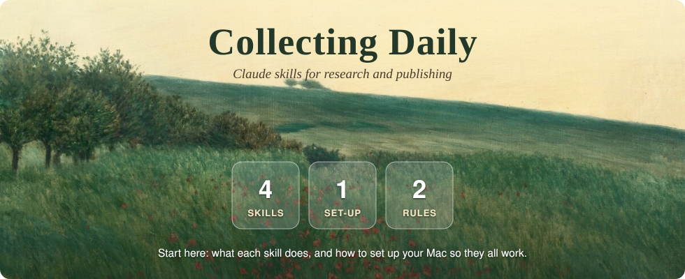
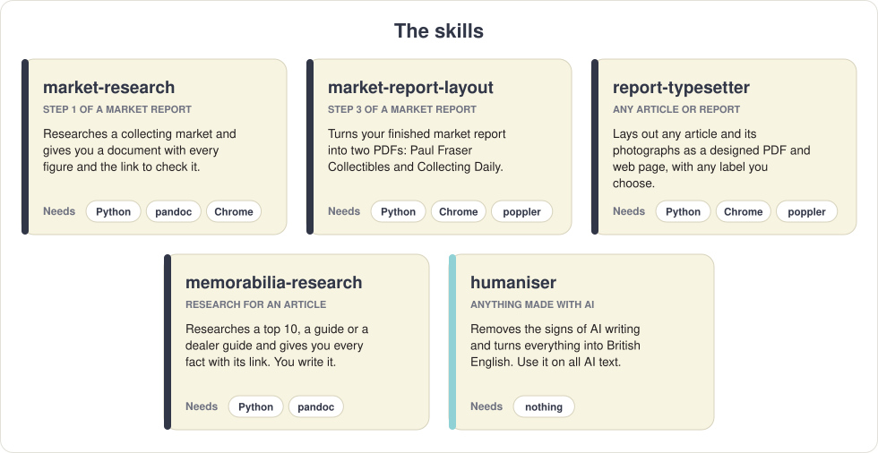
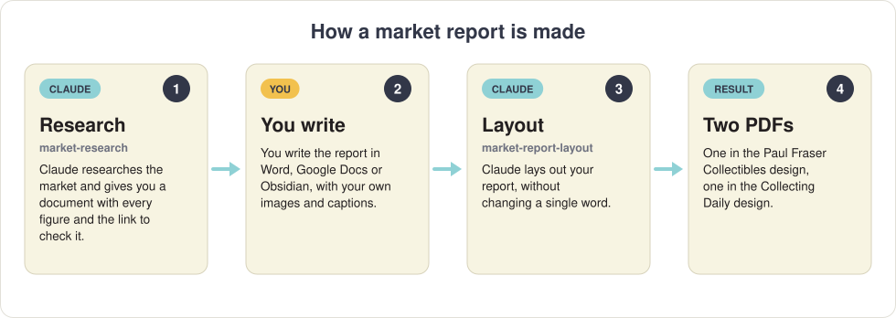
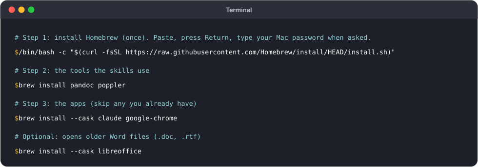
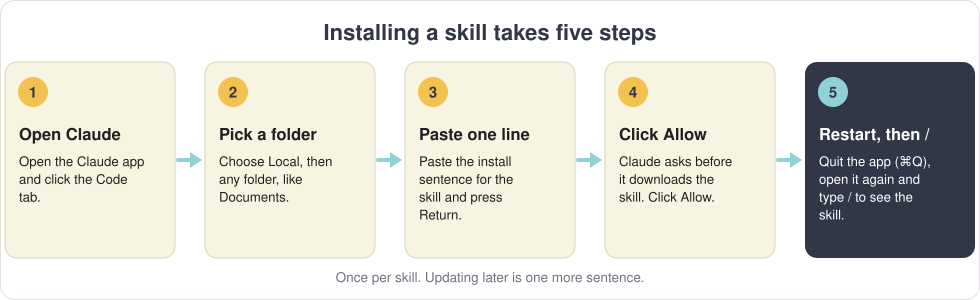

<p align="center"></p>

<p align="center">
  <a href="#the-skills"><strong>The skills</strong></a> ·
  <a href="#new-to-claude-read-this-first"><strong>New to Claude?</strong></a> ·
  <a href="#step-1-set-up-your-mac-once"><strong>1. Set up your Mac</strong></a> ·
  <a href="#step-2-install-the-skills"><strong>2. Install the skills</strong></a> ·
  <a href="#step-3-use-a-skill"><strong>3. Use a skill</strong></a> ·
  <a href="#help"><strong>Help</strong></a>
</p>

---

## The skills

<p align="center"></p>

| Skill | Use it when you want to… | Its page |
| --- | --- | --- |
| **market-research** | research a collecting market before you write a market report | [claude-market-research](https://github.com/CollectingDaily/claude-market-research) |
| **market-report-layout** | turn your finished market report into the PF and CD PDFs | [claude-market-report-layout](https://github.com/CollectingDaily/claude-market-report-layout) |
| **report-typesetter** | lay out any other article or report as a designed PDF | [claude-report-typesetter](https://github.com/CollectingDaily/claude-report-typesetter) |
| **humaniser** | make anything written with AI read like a person wrote it | [claude-humaniser](https://github.com/CollectingDaily/claude-humaniser) |

Each skill's page explains, with pictures, exactly what it does and what it needs from you.

### How a market report is made

<p align="center"></p>

### The two rules

> [!IMPORTANT]
> **1. Only a person writes what we publish.** The skills research, check and lay out. The words are always ours.
>
> **2. Anything made with AI goes through the humaniser** before it goes anywhere: the website, a newsletter, social media or a client.

---

## New to Claude? Read this first

A **skill** is a set of instructions and tools that teaches Claude one job, such as laying out a report. You install it once, and from then on Claude knows how to do that job. Six things to know:

1. **Use the Claude app on your computer, not the website.** The skills work with files and programs on your computer, which Claude in a web browser can't reach. You need a paid Claude plan (Pro, Max, Team or Enterprise).
2. **Use the Code tab.** The app has a few tabs at the top. Skills run in **Code**.
3. **Claude works inside a folder you choose.** When you start, it asks for a folder (**Local**, then **Select folder**). Pick the folder that holds your files for the job: your article and photographs, for example.
4. **Talk to it normally.** Type what you want in plain English and press **Return**. You don't need special words.
5. **Claude asks before it acts.** When it wants to run something on your computer, it shows you what and asks you to allow it. Read the line, and click **Allow** if it's what you asked for.
6. **One conversation per job.** Each conversation is a *session*. Start a new one for each new report.

---

## Step 1: set up your Mac (once)

The skills use a few free programs: one makes Word files, one reads PDFs, one draws the pages. **Homebrew** installs all of them with one line each, and keeps them up to date. **Every Mac should be set up the same way**, so every skill works the same for everyone and new skills can count on the same tools. It takes about ten minutes, once.

<p align="center"></p>

**Open Terminal.** Press **⌘ Command + Space**, type **Terminal**, and press **Return**. A window opens where you can paste commands. To run one: paste it, press **Return**, and wait until the window is ready for the next.

**Install Homebrew.** Copy this line exactly, paste it into Terminal and press **Return**:

```bash
/bin/bash -c "$(curl -fsSL https://raw.githubusercontent.com/Homebrew/install/HEAD/install.sh)"
```

- It asks for **your Mac password**. Type it and press **Return**. Nothing appears while you type: that's normal.
- It may ask you to press **Return** again, and it installs Apple's developer tools if your Mac doesn't have them yet. This takes a few minutes.
- **When it finishes, read the end of what it printed.** Under **Next steps** it shows two or three lines to copy and run. Do that, or Terminal won't find `brew` afterwards.

**Install the tools the skills use:**

```bash
brew install pandoc poppler
```

**Install the apps**, the Claude app and Google Chrome. If you already have one of them, leave it out of the line, or Homebrew will stop to say it's already there.

```bash
brew install --cask claude google-chrome
```

Then, in Chrome, add the **Claude** extension (*Claude in Chrome*) from the Chrome Web Store and sign in. market-research uses it to read auction pages behind your own logins.

**Optional: LibreOffice**, only needed to open older Word files (*.doc*, *.rtf*):

```bash
brew install --cask libreoffice
```

**Check it worked.** Run each line. Each should answer with a version number, not "command not found":

```bash
brew --version
pandoc --version
pdftoppm -v
python3 --version
```

**Python** and **git** come with Apple's developer tools, which Homebrew installed, so there's nothing extra to install for them.

---

## Step 2: install the skills

<p align="center"></p>

1. **Open the Claude app** and click the **Code** tab.
2. **Choose Local, then Select folder**, and pick any folder, such as **Documents**. (For installing, the folder doesn't matter.)
3. **Copy the sentence below** for the skill you want, paste it into the message box at the bottom, and press **Return**.
4. **Click Allow** when Claude asks to download the skill.
5. **Quit the Claude app completely** (**Claude** menu → **Quit**, or **⌘ Q**) and open it again. Then type **/** in the message box: the skill's name appears in the list. If it does, it's installed.

**All four skills at once:**

```text
Install these four skills from GitHub into ~/.claude/skills, each in a folder named exactly like its repository: https://github.com/CollectingDaily/claude-market-research https://github.com/CollectingDaily/claude-market-report-layout https://github.com/CollectingDaily/claude-report-typesetter https://github.com/CollectingDaily/claude-humaniser
```

**Or one at a time:**

market-research

```text
Install the skill from https://github.com/CollectingDaily/claude-market-research into ~/.claude/skills/claude-market-research
```

market-report-layout

```text
Install the skill from https://github.com/CollectingDaily/claude-market-report-layout into ~/.claude/skills/claude-market-report-layout
```

report-typesetter

```text
Install the skill from https://github.com/CollectingDaily/claude-report-typesetter into ~/.claude/skills/claude-report-typesetter
```

humaniser

```text
Install the skill from https://github.com/CollectingDaily/claude-humaniser into ~/.claude/skills/claude-humaniser
```

> [!TIP]
> **The folder name matters.** Each skill must sit in `~/.claude/skills/` in a folder named exactly like its repository, such as `claude-market-research`. The sentences above take care of that.

**market-research only:** the first time you use it, Claude sets up its research helpers and may ask you to start a new session. Do that, and ask again.

<details>
<summary><strong>Installing without Claude's help</strong></summary>

1. On the skill's page, click the green **Code** button, then **Download ZIP**, and double-click the ZIP to unzip it.
2. **Rename the folder**: GitHub adds `-main` to the end (`claude-humaniser-main`). Remove it, so it's exactly the repository's name (`claude-humaniser`).
3. In Finder, choose **Go → Go to Folder…**, type `~/.claude/skills` and press **Return**. (If it says the folder doesn't exist, type `~/.claude` instead and make a new folder called `skills` inside it.)
4. Drag the renamed folder into `skills`.
5. Quit the Claude app and open it again.

</details>

---

## Step 3: use a skill

Open the Claude app, click **Code**, and **select the folder that holds your files for the job**. Then either:

- type **/**, pick the skill from the list, and say what you want after it; or
- just say what you want in plain words, and Claude picks the right skill.

| You want to… | Type, for example |
| --- | --- |
| research a market | `/market-research Research the autographs market` |
| lay out your finished market report | `/market-report-layout Lay out the report in this folder` |
| lay out any other article | `/report-typesetter Make the report from the article and images in this folder. Label it BUYING GUIDE.` |
| humanise text | `/humaniser` and paste the text underneath |

Click **Allow** when Claude asks to run something for the job you asked for. Your finished files appear in the folder you selected.

### Keep your skills up to date

When a skill is improved, paste this into Claude (Code tab, any folder), click **Allow**, then quit and reopen the app:

```text
Update every skill in ~/.claude/skills that came from github.com/CollectingDaily to the latest version.
```

Once a month, also update the tools in Terminal:

```bash
brew update && brew upgrade
```

---

## What each tool is for

| Tool | What it does | market-research | market-report-layout | report-typesetter | humaniser |
| --- | --- | :---: | :---: | :---: | :---: |
| **Claude app** | runs every skill (Code tab, paid plan) | ✅ | ✅ | ✅ | ✅ |
| **Homebrew** | installs and updates everything below | ✅ | ✅ | ✅ | |
| **Python 3** | runs the skills' scripts | ✅ | ✅ | ✅ | |
| **Google Chrome** | draws the pages; reads pages behind logins | ✅ with the Claude extension | ✅ | ✅ | |
| **pandoc** | makes the Word copy of the research | ✅ | | | |
| **poppler** | reads the finished PDFs: page previews, and the check that both editions match | | ✅ | recommended | |
| **LibreOffice** | opens older Word files (.doc, .rtf) | | optional | optional | |

---

## Not on a Mac?

On **Windows**, report-typesetter, market-report-layout and humaniser are written to run too (they've been tested on a Mac only so far). Install **Python Install Manager** from the **Microsoft Store**; Microsoft Edge, which every Windows PC has, draws the pages. Install skills the same way, with the sentences above. **market-research needs a Mac.**

---

## Help

- **The skill doesn't appear when I type /.** Quit the Claude app completely (⌘ Q) and open it again. Still missing? Ask Claude: *Is the skill installed in ~/.claude/skills?*
- **"Command not found"** in Terminal or in Claude's messages usually means a tool from step 1 is missing. Run the checks in [Step 1](#step-1-set-up-your-mac-once).
- **Claude can't find my files.** It only sees the folder you selected. Start a new session and select the folder your files are in.
- **Anything else:** tell Claude what you did and paste the message you got. It can usually explain what went wrong.
